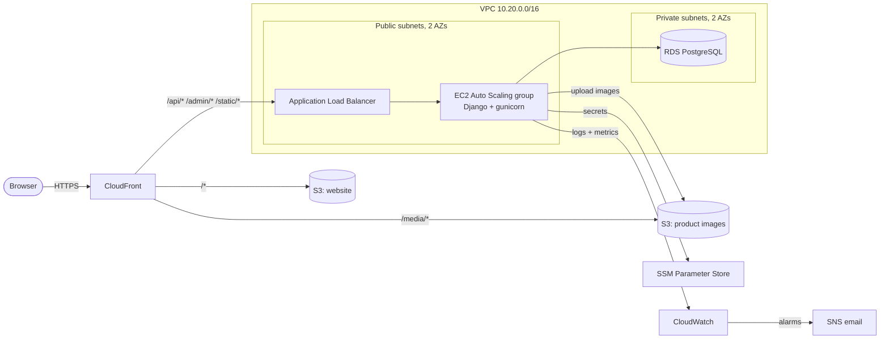

# Farm2Homez on AWS

The whole stack is defined as code in [`infra/farm2homez.yaml`](infra/farm2homez.yaml) (CloudFormation)
and deployed with one command by [`infra/deploy.sh`](infra/deploy.sh). It is built for the
**AWS Academy Cloud Foundations sandbox**, which deletes everything at the end of each 3-hour
session, so the app can be rebuilt from scratch in about 20 minutes whenever you need it.

## Architecture



| AWS service | Role in Farm2Homez |
|---|---|
| **CloudFront** | Single HTTPS entry point. Serves the React app and images from S3, and forwards `/api`, `/admin` and `/static` to the load balancer. Because everything shares one domain, there are no CORS or mixed-content problems and no custom domain or certificate is needed. A CloudFront Function sends React Router URLs such as `/cart` to `index.html`. |
| **S3** (2 buckets) | The built React website, and product images uploaded by sellers. Both are private; only CloudFront can read them (Origin Access Control). |
| **Application Load Balancer** | Spreads API traffic across healthy app servers and checks `/api/health/` every 15 s. It accepts traffic only from CloudFront's IP ranges. |
| **EC2 Auto Scaling** | 1–2 `t3.small` Amazon Linux 2023 servers running Django with gunicorn. Scales out at 60 % CPU and replaces unhealthy servers. New code rolls out with zero downtime. |
| **RDS PostgreSQL** | The database, in private subnets with no internet route, reachable only from the app servers and encrypted at rest. It also stores the cache (OTP codes, rate limits) so every app server shares it. |
| **VPC** | 2 public + 2 private subnets across 2 Availability Zones, security groups chained ALB → app → DB, and a free S3 gateway endpoint. No NAT gateway, to save cost. |
| **SSM Parameter Store** | Django secret key, JWT secret, DB password and optional SMTP credentials. App servers read them at boot through `LabRole`, so no secrets live in the code. |
| **CloudWatch** | App, access and boot logs; memory and disk metrics; a dashboard; alarms for API 5xx errors, unhealthy servers and high CPU. |
| **SNS** | Emails the alarms to you (optional). |
| **IAM** | The pre-created `LabRole` / `LabInstanceProfile` lets the servers use S3, SSM and CloudWatch without access keys. Session Manager replaces SSH. |

### Code changes made for AWS

- No Redis (ElastiCache isn't allowed in the sandbox). The cache uses the database when `REDIS_URL` is unset, and Celery tasks such as OTP emails run inline when no broker is set.
- Product images upload to S3 when `AWS_MEDIA_BUCKET` is set (`services/s3_service.py`), otherwise to Cloudinary as before.
- `STORAGES` replaces the settings Django 5.1 removed, so WhiteNoise compressed static files actually work.
- Rate limiting reads the real client IP from `X-Forwarded-For` behind CloudFront and the ALB. Before this, every user would have shared the load balancer's IP and its limit. Rate-limited requests now return 429 instead of 500.
- Without SMTP credentials, emails go to the app log, so OTP codes can be read in CloudWatch.
- New `/api/health/` endpoint for the load balancer.

## Deploying (every lab session)

1. In AWS Academy, open the sandbox and click **Start Lab**. When the dot is green, click **AWS**.
2. Make sure the region (top right) is **N. Virginia (us-east-1)**, then open **CloudShell** (the `>_` icon in the top bar).
3. Paste:

   ```bash
   git clone -b aws-deploy https://github.com/povellphilip/Farm2Homez.git && bash Farm2Homez/infra/deploy.sh
   ```

   Optional extras go before `bash`, for example:
   `ALERT_EMAIL=you@example.com SMTP_USER=you@gmail.com SMTP_PASSWORD='gmail app password' bash Farm2Homez/infra/deploy.sh`

4. Wait about 20 minutes. Progress shows in **CloudFormation → Stacks → farm2homez → Events**.
   CloudShell disconnects after about 20 idle minutes; the deployment keeps going. Just re-run the
   same `bash Farm2Homez/infra/deploy.sh` and it waits for it, then finishes the website upload.
5. The script prints the website URL plus demo logins:

   | Role | Email | Password |
   |---|---|---|
   | Admin | admin@farm2homez.com | Admin@12345 |
   | Seller | seller@farm2homez.com | Seller@12345 |
   | Customer | customer@farm2homez.com | Customer@12345 |

To deploy code changes during the same session, push them to the `aws-deploy` branch, then run
`cd Farm2Homez && git pull && bash infra/deploy.sh`. This replaces the app server with zero downtime.

## Cost

Everything is paid from Academy credits, not your own card. Approximate running cost:

| Resource | Per hour |
|---|---|
| EC2 `t3.small` × 1 | $0.021 |
| RDS `db.t3.micro` + 20 GB | $0.020 |
| Application Load Balancer | $0.023 |
| Public IPv4 addresses (ALB + EC2) | ~$0.015 |
| S3, CloudFront, CloudWatch, SNS, SSM | ≈ $0 (free tier) |
| **Total** | **≈ $0.08 / hour** (about $0.25 per 3-hour session) |

The sandbox deletes everything when the session ends, so nothing bills overnight.

## Troubleshooting

| Symptom | Where to look |
|---|---|
| Stack fails | The script prints the first errors. Also see CloudFormation → Events, filtered to "Failed". |
| `AppAutoScalingGroup` times out | CloudWatch → Log groups → `/farm2homez/farm2homez/app` → `*/bootstrap` shows the server setup log. Or EC2 → instance → Connect → Session Manager, then `sudo tail -100 /var/log/farm2homez-bootstrap.log`. |
| API errors (5xx) | Same log group, `*/app` streams, or the "Recent app errors" widget on the dashboard. |
| Need the sign-up OTP | `*/app` log stream; search for `OTP`. |
| Secrets are empty on the server (KMS blocked) | Re-run with `PLAIN_PARAMS=1 bash Farm2Homez/infra/deploy.sh`. |

To tear down early (to free up credits), empty the two website/media buckets in S3, then delete the
`farm2homez` stack in CloudFormation.

## For the project report

- Architecture diagram (above), explaining why each service was chosen
- Security group table: ALB ← CloudFront only on 80; app ← ALB only on 8000; DB ← app only on 5432
- High availability: 2 AZs, ALB health checks, Auto Scaling self-healing and scale-out
- Security: private DB subnets, private S3 with OAC, HTTPS everywhere, secrets in SSM, no SSH
- Cost estimate (table above, or the AWS Pricing Calculator)
- Screenshots: CloudFormation resources, the running site, the CloudWatch dashboard, an alarm, Auto Scaling activity
- Infrastructure as code: the whole environment is reproducible from one template
